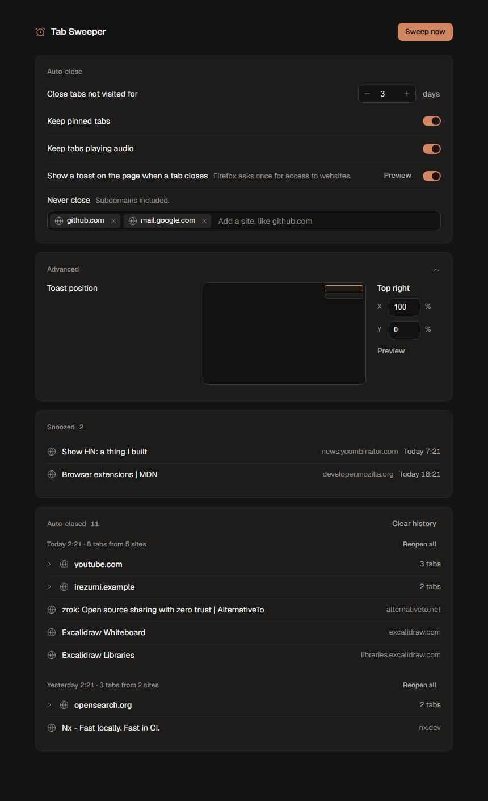
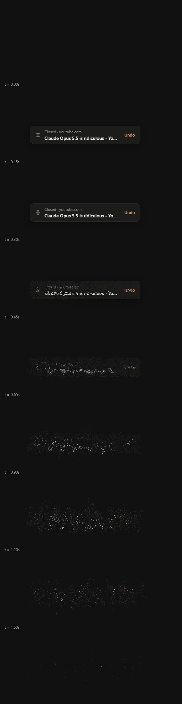
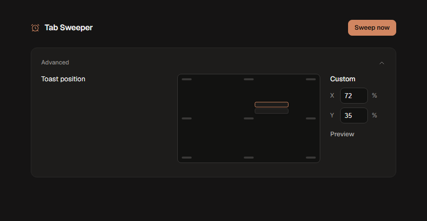

# Tab Sweeper

A Firefox extension that closes tabs you haven't looked at in a few days, and lets you snooze a tab until later.

I keep a hundred tabs open "for later" and never go back to most of them. Tab Sweeper closes the ones I clearly forgot. Every closed tab goes into a log, so getting one back takes a click.



## What it does

Auto-close checks every 30 minutes. A tab you haven't visited in N days gets closed. The default is 7 days, and 0 turns auto-close off. Pinned tabs, tabs playing audio and sites on your "Never close" list are skipped. A site on that list covers its subdomains too.

The settings page keeps a log of closed tabs. Tabs closed in the same sweep stay together, grouped by site. Reopen one tab, a whole site or the whole sweep.

To snooze a tab, right-click it and pick a time.

- In 1 hour
- In 3 hours
- This evening, 18:00. Hidden after 18:00.
- Tomorrow, 9:00
- Next week, Monday 9:00
- Custom, which opens a small picker for a date and time or a duration

A snoozed tab closes right away and comes back at that time in the same container.

The sidebar lists snoozed tabs, the tabs that will close next, and recently closed tabs.

## The toast

You can turn on a small notice that shows up on the page you're looking at when tabs get closed. It has an Undo button. After about 4 seconds it breaks into dust and drifts off.



The dust effect is a port of the one in [Telegram for iOS](https://github.com/TelegramMessenger/Telegram-iOS/tree/master/submodules/TelegramUI/Components/DustEffect). Their version is a Metal shader. This one runs on a 2D canvas. Each grain starts as one exact pixel of a snapshot of the toast, so you can't see the moment the canvas replaces the real element. A ragged edge sweeps left to right. Grains just ahead of it shake, then come loose, shrink to a single pixel and float up on a swirling noise field. It takes about 1.5 seconds and costs around 4 to 5 ms a frame.

Under Advanced you pick where the toast appears. Click one of nine spots, type X and Y as a percent of the window, or drag the little toast in the preview.



The toast needs access to all websites, because it draws inside the page. Firefox asks for that the first time you turn it on. With the toast off, the extension never touches page content.

## Install

Grab the signed `.xpi` from [Releases](../../releases) and drag it into a Firefox window. You need Firefox 142 or newer.

The build is signed by Mozilla as an unlisted add-on, so it installs permanently and stays after a restart. It isn't on addons.mozilla.org.

## Build from source

You need [Bun](https://bun.sh).

```sh
bun install
bun run build        # writes the extension to dist/
bun run typecheck
```

To try it without signing, open `about:debugging#/runtime/this-firefox`, click "Load Temporary Add-on" and pick `dist/manifest.json`. Firefox drops a temporary add-on on restart.

To sign your own copy, get API keys from the [AMO developer hub](https://addons.mozilla.org/developers/addon/api/key/). Change the `gecko.id` in `static/manifest.json` to your own. Then run this:

```sh
WEB_EXT_API_KEY=... WEB_EXT_API_SECRET=... bunx web-ext sign -s dist --channel=unlisted
```

## Layout

| Path | What's in it |
| --- | --- |
| `src/background.ts` | Sweeps, snooze alarms, the context menu, the favicon cache |
| `src/toast.ts` | The on-page toast, injected only when it's needed |
| `src/dust.ts` | The dust effect |
| `src/options.ts` | Settings page |
| `src/sidebar.ts` | Sidebar |
| `src/custom.ts` | Custom snooze popup |
| `src/shared.ts` | Types, storage and time helpers |
| `static/` | Manifest, HTML, CSS and the bundled font |
| `build.ts` | Bundles `src/`, copies `static/` and inlines the icons |

Icons come from [Lucide](https://lucide.dev). The build inlines them as SVG at a 1.5px stroke. The font is [Geist](https://vercel.com/font), included under the SIL Open Font License in `static/fonts/OFL.txt`.

## Storage

All data stays in `browser.storage.local` on your machine. That means your settings, the snoozed tabs, the closed-tab log and a small cache of site icons. Nothing gets sent anywhere.

## License

MIT
